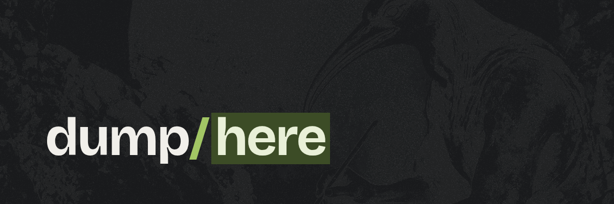
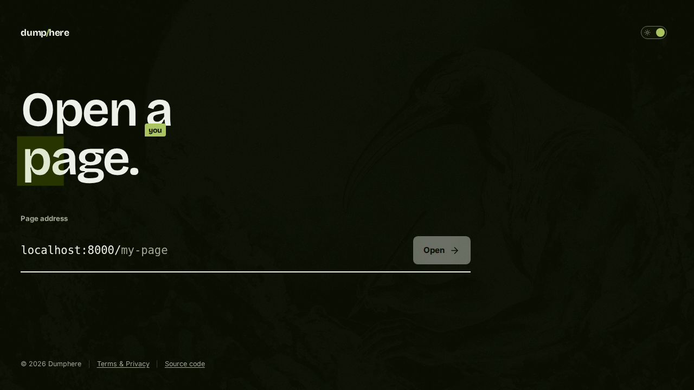

A public, collaborative Markdown editor where the URL path is the document.
Pick an address, share the link, and everyone writes together. There is no
sign-up and nothing to configure. Built with Nuxt, Tiptap, Yjs and
Appwrite.

Anyone who knows or guesses an address can read and edit it, and documents
untouched for 30 days are deleted. Keep anything sensitive, or anything you
cannot afford to lose, somewhere else.



## Architecture

The app runs on a self-hosted [Appwrite](https://appwrite.io) server.

- `sites/app`: Nuxt 4 single-page app with Tiptap and Yjs, served by Appwrite Sites.
- `functions/documents`: PHP 8.4 Appwrite Function with the document rules: open or create a page, save its HTML, list the page tree, delete, address settings, password recovery.
- `functions/admin`: reserves an address and, every day, deletes documents untouched for 30 days.
- `yjs-server`: the collaboration WebSocket, in a container next to Appwrite. It stores Yjs snapshots in Appwrite TablesDB.
- `appwrite.config.json`: database, tables, functions and site.

Rooms use the document's immutable row ID; the slug is only the public URL. IndexedDB keeps a local, offline cache per document.

## Local development

Requirements: PHP 8.4+ with Composer, Node 24 LTS and the Appwrite CLI logged in to the server.

```bash
for f in functions/*/; do (cd "$f" && composer install); done
cd sites/app && cp .env.example .env && npm ci && npm run dev
```

The site on `localhost:3000` talks to the `dumphere-dev` project and its collaboration server. To run the collaboration server locally, copy `yjs-server/.env.example` to `yjs-server/.env`, fill in an API key of the dev project and run `npm --prefix yjs-server run dev`; then point `NUXT_PUBLIC_YJS_URL` at `ws://localhost:1234`.

## Deployment

[docs/deploy.md](docs/deploy.md) covers both environments, the collaboration container, reserving addresses and the daily cleanup. Decisions are in [docs/decisions](docs/decisions) and the tables in [docs/dados.md](docs/dados.md).

## Verification

```bash
(cd functions/documents && composer lint && composer test)
(cd functions/admin && composer lint)
(cd sites/app && npm run lint && npm run format:check && npm run typecheck && npm test)
npm --prefix yjs-server test
```

## Forking and rebranding

The name lives in `sites/app/app/Lib/brand.ts`. A fork also replaces the
`Wordmark.vue` glyph, the images under `sites/app/public/images/`, and the terms
text in `sites/app/app/i18n/locales/`, which describes one specific deployment's
policy and should not be copied verbatim.

## License

[AGPL-3.0-or-later](LICENSE). You can run, modify and redistribute this, but if
you offer a modified version to users over a network, you have to offer them its
source too. The footer link to this repository is what satisfies that for the
unmodified version; a fork points it at its own source in
`sites/app/app/Lib/brand.ts`.

Security reports go through [SECURITY.md](SECURITY.md), not public issues.
